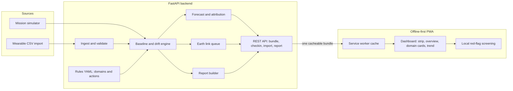
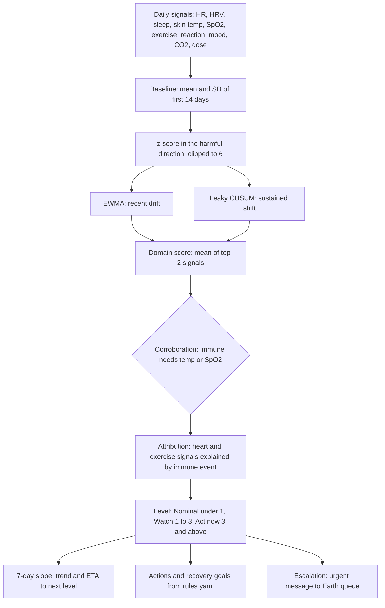
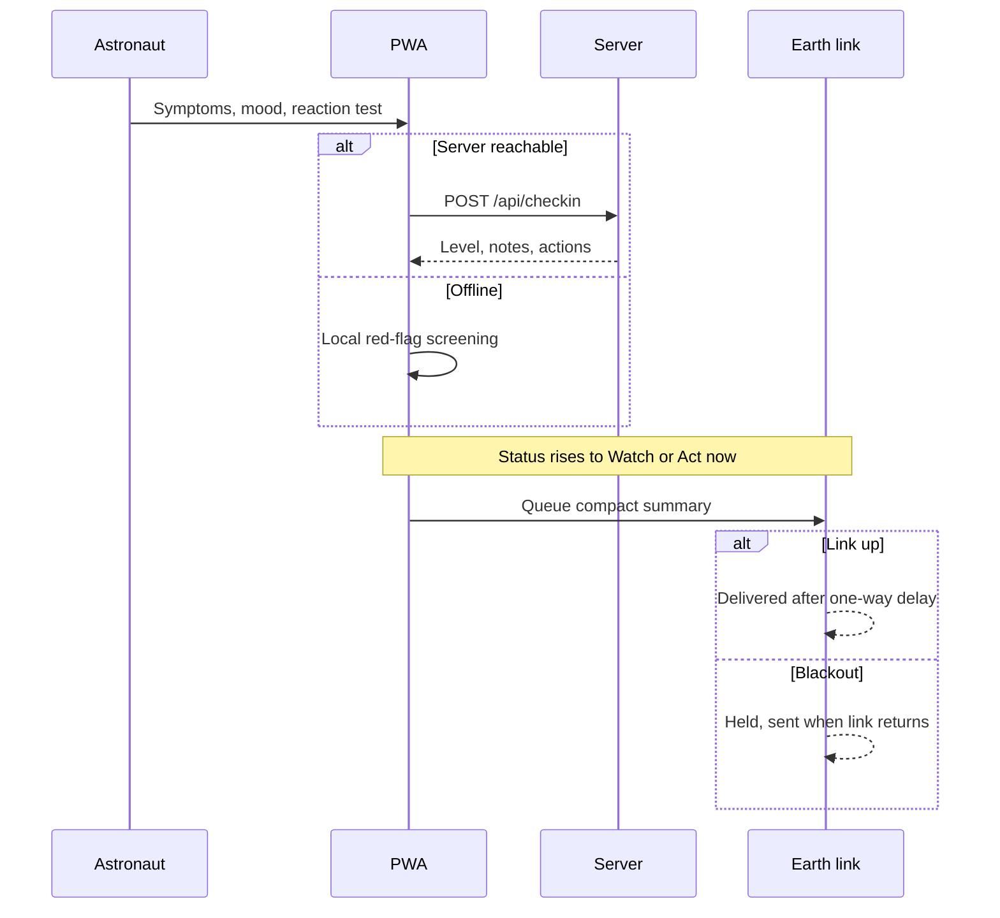
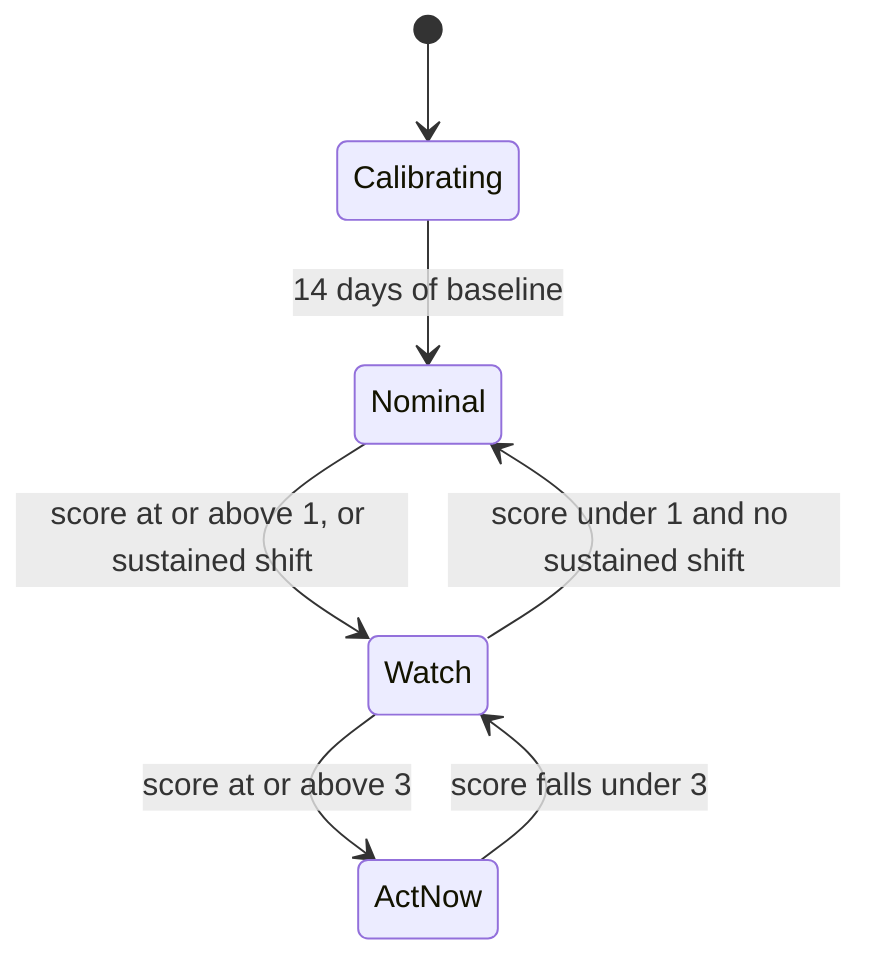

# AstroTwin: an offline-first health copilot for astronauts

> NASA Space Apps Challenge 2026: *Create Health Monitoring Software for Astronauts on Space Missions*

On a long mission the astronaut is the first line of medical care, and Earth may be 20 minutes away or out of contact.
AstroTwin runs **on the crew side**: it learns each astronaut's *own* baseline, spots drift across the five spaceflight
hazard domains, **explains** every flag, **forecasts** where a trend is heading, tells the astronaut **what to do**, and
queues compact summaries for Earth with store-and-forward delivery. It works with the network off.

All demo data is **simulated**. See [Limitations](#limitations-and-ethics).

## Features

| Feature | What it does |
|---|---|
| Personal baselines | Each person is compared with their own first 14 days, not population norms |
| Five hazard domains | Immune, behavioral health, bone/muscle/heart, cabin air, radiation, mapped to NASA's human-spaceflight hazards |
| Explainable flags | Every alert lists the contributing signals, the size of the shift, and how long it has lasted |
| Early-warning forecast | 7-day trend per domain with a projected time to the next level ("reaches red in about 9 days") |
| Cause attribution | Heart-rate, HRV and exercise changes during an immune event are not misread as deconditioning |
| Recovery goals and actions | Each flag shows a target ("back above 6.7 h") and a suggested countermeasure from an editable rule file |
| Crew overview | Who needs attention first, crew readiness, and a team-strain indicator |
| Delay-tolerant Earth link | Priority and routine messages, held during blackouts and forwarded when the link returns |
| Privacy control | The astronaut can withhold behavioral details from the ground; only the level is shared |
| Bring your own data | Import a wearable CSV and get the same analysis on your own numbers |
| Offline-first PWA | Installable; after one load the full dashboard, forecasts and screening work without a server |
| Flight-surgeon report | One-click Markdown report with status, drivers, goals, 14-day table and queued messages |
| Daily check-in | Symptom screening plus a 1-minute reaction-time test; red-flag symptoms always escalate |

## Quick start

```bash
git clone <your-repo-url> astrotwin && cd astrotwin
./run.sh                 # venv, deps, tests, then http://localhost:8000  (API docs at /docs)
```

Docker: `make docker` (or `docker build -t astrotwin . && docker run --rm -p 8000:8000 astrotwin`).

**Try it in 60 seconds:** press *Play mission*, watch the strip fill in, click a coloured cell, open a card to see why it
flagged, then use *Import wearable CSV* with `static/sample_wearable.csv`.

## Architecture



### Analysis pipeline



### Check-in and store-and-forward



### Status levels



More detail: [docs/ARCHITECTURE.md](docs/ARCHITECTURE.md) and [docs/METHODOLOGY.md](docs/METHODOLOGY.md).

## Challenge mapping

| Challenge text | AstroTwin |
|---|---|
| Space radiation | Radiation card: acute dose spike detection, cumulative dose against a planned budget, shelter procedure |
| Isolation and confinement | Behavioral card: mood, sleep, reaction time; team-strain indicator; privacy control |
| Altered gravity (bone loss, cardiovascular) | Bone, muscle and heart card: exercise load, resting HR, HRV, with forecast |
| Hostile closed environment | Cabin air card; immune card with infection signature |
| Immune changes, cardiovascular events | Immune card with temperature or SpO2 corroboration; chest pain and similar symptoms always escalate |
| Astronauts spot changes in themselves | Personal baselines, plain-language explanations, recovery goals and actions on the crew device |

## API

Interactive docs at `/docs`.

| Method and path | Purpose |
|---|---|
| `GET /api/bundle` | Everything the client needs (statuses, series, queue, summaries); cached for offline use |
| `GET /api/meta` | Crew list, metrics, link delay curve, blackout window |
| `GET /api/crew/{id}/status/{day}` | One astronaut on one day, with forecast |
| `GET /api/summary/{day}` | Crew overview and attention ranking |
| `GET /api/earth-queue?upto=D` | Queued messages |
| `GET /api/crew/{id}/report?day=D` | Markdown report download |
| `POST /api/checkin` | Symptom, mood and reaction triage |
| `POST /api/import` | Add a wearable CSV as a crew member |

## Using your own data

CSV, one row per day, at least 15 rows (the first 14 learn the baseline). Recognised columns include
`resting_hr, hrv_rmssd, sleep_hours, skin_temperature, spo2, active_minutes` and the native names in
`app/ingest.py`. Missing metrics are held flat so they never raise a flag.

## Project structure

```
app/            simulator.py  engine.py  ingest.py  report.py  main.py  rules.yaml
static/         index.html  app.js  style.css  sw.js  manifest.webmanifest  icon.svg  sample_wearable.csv
tests/          test_engine.py  test_api.py
docs/           ARCHITECTURE.md  METHODOLOGY.md  PITCH.md
.github/        workflows/ci.yml
Dockerfile  Makefile  run.sh  requirements*.txt  LICENSE
```

## Testing

`make test` runs the Python tests and a JavaScript syntax check. The tests cover detection of every injected event,
zero false alarms in the quiet windows, cause attribution, forecast, recovery goals, the blackout queue, report,
import validation, and that the PWA assets are served.

## Limitations and ethics

- Data is simulated. Directions of change follow published spaceflight physiology; magnitudes are invented.
- Thresholds (Watch at 1, Act now at 3) and every action in `rules.yaml` are illustrative and **not clinically validated**.
  Real procedures must come from flight surgeons.
- Decision support only, not a diagnostic device.
- Imported data is held in server memory for the session; nothing is persisted or sent elsewhere.
- Radiation numbers (about 1.8 mSv per day in deep-space cruise) are order-of-magnitude values; verify before citing.

## Roadmap

1. Wearable device integrations (BLE and vendor exports) and on-device storage in IndexedDB.
2. Calibrating effect sizes against NASA OSDR processed datasets.
3. Per-person baseline refresh and circadian modelling.
4. Local language model for protocol Q&A, grounded in a vetted protocol library.
5. Flight-surgeon review loop and validation study design.

## References

- Garrett-Bakelman et al., *The NASA Twins Study*, Science, 2019.
- Scott et al., *Biomonitoring and precision health in deep space supported by artificial intelligence*, Nature Machine Intelligence, 2023.
- *Inspiration4 data access through the NASA Open Science Data Repository*, npj Microgravity, 2024 (nature.com/articles/s41526-024-00393-5).
- NASA Human Research Program, hazards of human spaceflight (radiation, isolation and confinement, distance from Earth, gravity fields, hostile and closed environments).

## License

MIT. See [LICENSE](LICENSE).
